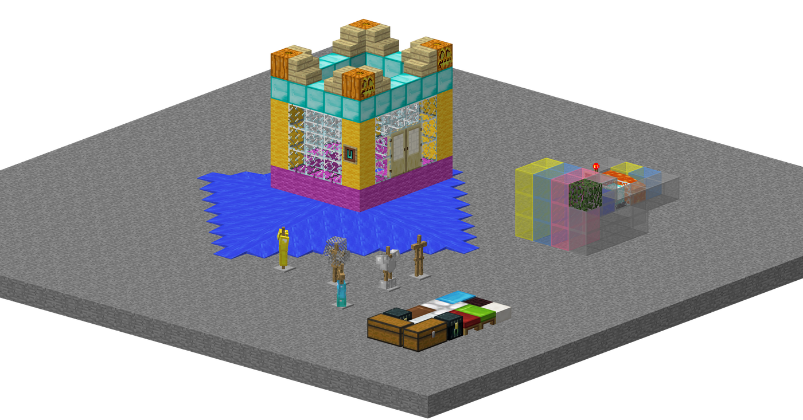

# IsoRender

A client-side Minecraft 1.12.2 mod (LiteLoader) that turns a region of your world into an isometric PNG render with a transparent background.



## Features

- Select a region with two points (`/isorender pos1`, `/isorender pos2`); a yellow outline shows the selection in the world.
- Interactive menu (key **K**) with a **live preview**: rotation, elevation, zoom, offset, view (isometric or perspective), background of the preview and output resolution.
- Isometric view by default (rotation 45°, elevation 35.264°), plus a perspective view and Isometric / Front / Top presets.
- Square PNG from 512 to 4096 px, with real alpha: transparent background, correct translucency (glass, water, ice) and smoothed edges without halos.
- Height cut (**Cut Y**) to look inside a build by removing the top layers.
- Draws blocks (real state, biome tint), block entities (chests, beds, signs, heads, banners...) and item frames, paintings and armor stands.
- `/isorender item` renders a single item or block, from your hand or by ID, as it looks in the inventory.
- Settings are remembered in `isorender.properties`; files are never overwritten (unique names).
- Read-only: the mod never modifies blocks or entities. A failure in selection, render or menu is reported in the chat and does not close the game.

## Requirements

- Minecraft Java Edition **1.12.2**
- **LiteLoader 1.12.2** installed in that profile. Forge is not used.
- Client-side only: nothing to install on a server, and the mod never changes the world.
- A GPU with OpenGL and framebuffer support. 4096 px with smoothed edges needs a maximum texture size of 8192 px (otherwise it still works, without edge smoothing).

## Installation

1. Install LiteLoader 1.12.2 in your Minecraft 1.12.2 profile (see [liteloader.com](https://www.liteloader.com/)).
2. Download `mod-isorender-1.0.0-mc1.12.2.litemod` from the [Releases](https://github.com/judamar/IsoRender/releases) page and copy it, without unzipping it, into `<game directory>/mods/`.
3. Start the game with the LiteLoader profile and enter a world. The chat shows `[IsoRender] Mod loaded (v1.0.0).`

## Quick start

1. Aim at one corner of a build and type `/isorender pos1`.
2. Aim at the opposite corner and type `/isorender pos2`. The chat shows `Region: W × H × D blocks.`
3. Press **K** (or type `/isorender menu`) to open the menu and adjust the camera while watching the preview.
4. Press **Render**. The PNG is saved in `<game directory>/isorender/` and the chat shows its path (click it to open the image).

You can also skip the menu: `/isorender render` renders with the last camera, resolution and Y cut used in the menu.

## Commands

Commands are handled by your client and are never sent to the server. They are lowercase and have no Tab completion.

| Command | What it does |
|---|---|
| `/isorender pos1` | Set point 1 on the aimed block (or the block under your feet if you are not aiming at one). |
| `/isorender pos2` | Set point 2 the same way. |
| `/isorender clear` | Clear the selection. |
| `/isorender menu` | Open the menu (same as the K key). |
| `/isorender render` | Render the region with the menu's camera, resolution and Y cut. Takes no arguments. |
| `/isorender item [id] [meta]` | Render the item in your hand (the off hand if the main one is empty), or an item/block by ID and metadata, e.g. `/isorender item minecraft:wool 14`. |
| `/isorender test`, `test-multi`, `stress` | Debug commands; they write to `<game directory>/isorender-test/` and ignore `outputFolder`. See the manual. |

## Menu overview

- **Rotation**, **Elevation**, **Zoom**, **Offset X**, **Offset Y**: a slider and a numeric field each.
- **Background** (preview only): Checkerboard, White, Gray, Black, Chroma green. The exported PNG is always transparent.
- **View**: Isometric or Perspective.
- **Resolution**: 512, 1024, 2048 or 4096 px, or any integer from 512 to 4096 in the field.
- **Isometric / Front / Top** presets, **Cut Y**, **Reset**, **Render** and **Close**.
- Regions larger than 32 × 32 × 32 use a simplified preview (lower quality, no entities); the final PNG is always full quality.

## Configuration

File: `<game directory>/liteconfig/common/isorender.properties`, created on first start. Edit it with the game closed (it is rewritten when the menu closes, and changes made while the game is open are lost).

| Key | Values | Default |
|---|---|---|
| `outputFolder` | folder path (relative to the game directory, or absolute); empty = `<game>/isorender` | empty |
| `resolution` | integer 512 to 4096 | `512` |
| `rotation` | 0 to 359 | `45.0` |
| `elevation` | 5 to 90 | `35.264` |
| `zoom` | 25 to 400 (%) | `100.0` |
| `offsetX`, `offsetY` | -100 to 100 (%) | `0.0` |
| `view` | `iso` or `persp` | `iso` |
| `background` | `CHECKERBOARD`, `WHITE`, `GRAY`, `BLACK`, `GREEN` (preview only) | `CHECKERBOARD` |
| `maxSize` | 1 to 64 (maximum region size per axis; cannot exceed 64) | `64` |

An invalid value only resets that key to its default; the reason is written to `logs/latest.log`. The menu saves camera, view, resolution and background; `outputFolder` and `maxSize` are edited by hand.

## Output

PNG files are 32-bit RGBA and square, named:

- `structure_<yyyyMMdd-HHmmss>_<x1,y1,z1>_<x2,y2,z2>.png`, for example `structure_20261114-152831_-4,4,-4_-2,4,1.png` (the coordinates are the region's minimum and maximum corners, with the Y cut applied).
- `item_<yyyyMMdd-HHmmss>_<id>_<meta>.png`, for example `item_20261114-120000_minecraft-diamond_sword_0.png`.

If a name already exists, `_2`, `_3`... is appended; nothing is overwritten.

## Limitations

- Regions up to 64 × 64 × 64 blocks, and only chunks your client has loaded.
- Only vanilla blocks are guaranteed; blocks from other mods are best-effort.
- Only item frames, paintings and armor stands are drawn as entities (plus block entities). No mobs, players, dropped items or leads.
- A region with only an armor stand or an item frame and no block is rejected as "only air".
- Fixed full lighting (the same image day or night); the background is always transparent and the image always square.
- A Y cut outside the region is ignored without a warning; the cut is not saved and Reset does not clear it.
- `/isorender` is case-sensitive and has no Tab completion; an empty resolution field means 512.
- Tested on a vanilla 1.12.2 client with LiteLoader and no other mods; compatibility with other mods or with Forge is not guaranteed.

See the [wiki](https://github.com/judamar/IsoRender/wiki) for the full list and troubleshooting.

## Building from source

Requirements: JDK 8 and the Gradle wrapper included in the repository (Gradle 4.10.3). The build uses ForgeGradle (`com.anatawa12.forge:ForgeGradle:2.3-1.0.+`, LiteLoader flavour), MCP mappings `snapshot_20170624` and LiteLoader `1.12.2-SNAPSHOT`.

```
./gradlew setupDecompWorkspace   # once
./gradlew build                  # compiles, runs the tests and packages
```

The result is `build/libs/mod-isorender-1.0.0-mc1.12.2.litemod`. To run only the tests: `./gradlew test`. `gradle.properties` pins the JDK with `org.gradle.java.home`; change it to your JDK 8 path.

With a clean Gradle cache, `setupDecompWorkspace` can fail with `ZipException: invalid entry compressed size` (seen with JDK 8u512). The workaround is to repack every `*-sources.jar` under `~/.gradle/caches/modules-2/files-2.1` without compression (STORED) and delete `~/.gradle/caches/minecraft/deobfedDeps/**/*sources*`. Details are in the wiki page [Building from Source](https://github.com/judamar/IsoRender/wiki/Building-from-Source).

## Documentation

- [Wiki](https://github.com/judamar/IsoRender/wiki): installation, quick start, commands, menu, configuration, output files, troubleshooting, limitations and technical overview.
- `docs/MANUAL.md` (user manual) and `docs/TECNICA.md` (technical documentation) are in English.
- The rest of `docs/` (ERS, PLAN, test cases, environment, licenses, LiteLoader API notes) are internal project documents written in Spanish.

## License

[MIT](LICENSE), (c) 2026 judamar.

IsoRender is not affiliated with, endorsed by or associated with Mojang or Microsoft; Minecraft is a trademark of Mojang. It requires LiteLoader, which is not included and is installed separately. The mod contains no code or resources taken from other isometric-render projects, and it does not bundle Minecraft textures or models: the images are drawn at run time from your own Minecraft client. The PNGs you generate are your own work, made from your own world. The third-party review is in `docs/LICENCIAS.md`.
